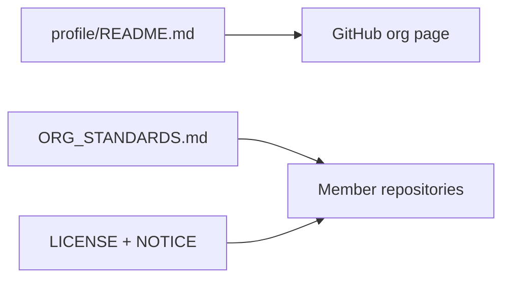

# HackerX-official `.github` repository

Organization defaults hosted here:

- `profile/README.md` — GitHub org landing page
- `LICENSE` / `NOTICE` — HackerX License v1.0 source of truth
- `SECURITY.md` — Coordinated disclosure template
- `ORG_STANDARDS.md` — Required files and CI conventions for member repos

Member repositories copy or reference these artifacts; they do not import this repo as a submodule.

## High-level flow

## Module map

| Path | Responsibility |
| --- | --- |
| `profile/README.md` | Org profile: tooling index, links, license row |
| `ORG_STANDARDS.md` | Checklist: LICENSE, NOTICE, SECURITY, ARCHITECTURE, CI |
| `workflows/ci.yml` | Validates required artifacts on push/PR |
| `LICENSE` / `NOTICE` | Canonical HackerX License v1.0 text |
| `SECURITY.md` | Disclosure and authorized-use template |

## Testing strategy

CI job `standards` runs on every push to `main` and on pull requests — file presence checks only (no deploy).

## Ethics & scope

This repository publishes organizational defaults and documentation. It does not execute assessments against third-party systems.
